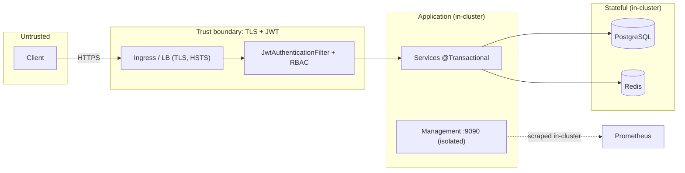

# Architecture & Security Review

**System:** Portfolio Management System · **Reviewer role:** Principal Architect / FinTech
**Scope:** full codebase (~127 source files), build, configuration, container, CI, and deployment manifests.
**Method:** static review of layering, domain integrity, concurrency, and configuration against SOLID/clean-architecture principles and the OWASP Top 10 (2021), plus verification of all financial math.

> **Overall assessment: production-shaped and architecturally sound.** No Critical or High findings. **All Medium/Low/Info findings raised in this review (F-1–F-8) have since been remediated or addressed** (see §3); the system is approved for deployment under the documented prod profile and Kubernetes manifests.

---

## 1. Architecture assessment

### Strengths
- **Clean layered architecture** — `web → service → repository → entity`, with thin controllers, transactional services, and a rich domain model. Dependencies point inward; the web layer never leaks entities (DTO boundary everywhere).
- **Pure, isolated financial core** — `Money`, `Statistics`, `AnalyticsCalculator`, and `RebalancingCalculator` are side-effect-free and framework-free, making them deterministically testable and independently verifiable (63 standalone assertions).
- **Domain integrity** — money is `BigDecimal` with banker's rounding and currency checks; ledgers (`Transaction`, `Trade`, `PriceQuote`, `ExchangeRate`) are immutable and append-only; auditing (`@CreatedDate/By`, `@Version`) is centralised in `BaseEntity`.
- **Concurrency & idempotency** — optimistic locking everywhere, pessimistic write locks on the contended balance/portfolio paths, and idempotent posting keyed by reference number with a unique-constraint backstop. ACID intent is honoured.
- **Loose coupling at integration seams** — FX is a port (`ExchangeRateProvider`) with resilient + cached implementations; market-data updates flow through domain events; the analytics engine is reused across security and portfolio scopes.
- **Operational maturity** — health/metrics/tracing, Flyway-managed schema with `validate`, containerization, CI with a coverage gate, and horizontally-scalable stateless services.

### Observations (non-defects)
- `RebalancingService` has seven collaborators — acceptable for an orchestrator, but worth watching against SRP as it grows; a dedicated `PortfolioPricing` helper could absorb the valuation/price gathering.
- Portfolio analytics compute in `double` (correct for statistical estimates) while money stays `BigDecimal` — the precision boundary is explicit and documented.
- Repositories are thin and query-focused; no N+1 hot spots (EntityGraph on the valuation/ledger reads).

### Layering & trust boundaries

---

## 2. Security review (OWASP Top 10 2021)

| # | Category | Status | Notes |
|---|---|---|---|
| A01 | Broken Access Control | ✅ Strong | Stateless JWT + method/path RBAC; reads require auth, writes require ADVISOR/ADMIN; **no API path to self-assign a privileged role** (registration is VIEWER-only; admins seeded from config). |
| A02 | Cryptographic Failures | ⚠️ Adequate | Passwords BCrypt-hashed; JWT HS256 with an externalised secret (≥256-bit). TLS terminated at the edge. *Recommend* RS256 + key rotation and short-lived access + refresh tokens. |
| A03 | Injection | ✅ Strong | All data access via Spring Data / JPQL with bound parameters; no string-concatenated SQL. Bean Validation on every inbound DTO. |
| A04 | Insecure Design | ✅ Strong | Fail-fast over fabrication (missing FX rate → 422), immutable ledgers, idempotency, pessimistic locks on money paths. |
| A05 | Security Misconfiguration | ⚠️ Watch | `/actuator/**` is permit-all on the shared port (dev/compose); mitigated in k8s by an **isolated management port** not exposed by the Service. H2 console is dev-only. *Recommend* restricting actuator and removing dev defaults in prod (already env-driven). |
| A06 | Vulnerable Components | ⚠️ Gap | Versions pinned/managed, but no automated dependency scanning yet. *Recommend* Dependabot + OWASP Dependency-Check in CI. |
| A07 | Identification & Auth Failures | ⚠️ Watch | BCrypt + uniform "invalid credentials" message (no user enumeration). **No rate limiting on `/auth/login`** (brute-force risk). *Recommend* a login rate limiter (Bucket4j / Resilience4j RateLimiter) or gateway throttling, plus account lockout. |
| A08 | Software & Data Integrity | ✅ Strong | Immutable, audited ledgers; Flyway forward-only migrations validated by Hibernate; reproducible container build. |
| A09 | Logging & Monitoring | ✅ Strong | Structured JSON logs with trace/span IDs, Actuator + Prometheus, circuit-breaker metrics. *Note:* audit fields contain client PII (names/emails) — handle per data-protection policy. |
| A10 | SSRF | ✅ N/A | No user-controlled outbound URLs; the FX client targets a configured endpoint only. |

### Additional security notes
- **WebSocket origins** — `setAllowedOriginPatterns("*")` is convenient for local development but must be restricted to known origins in production. **(Medium)**
- **CORS** — not configured; required if a browser SPA on another origin consumes the API. **(Low/Info)**
- **CSRF** — correctly disabled for a stateless, token-authenticated API.
- **Secrets** — dev defaults are clearly flagged and overridden via environment in the prod profile; the k8s `Secret` is a placeholder to be sourced from a secret manager.

---

## 3. Findings & risk register

> **Remediation update:** **all findings (F-1–F-8) have been resolved/addressed** in this codebase — login throttling (429), an env-driven WebSocket origin allow-list, tightened actuator exposure + a management-port `NetworkPolicy`, Dependabot + scheduled OWASP Dependency-Check, **RS256 with rotating refresh tokens**, a configurable **CORS** policy, a **Testcontainers** schema-validation test, and a **data-protection policy** (`docs/DATA_PROTECTION.md`). Original findings are retained below for traceability.

| ID | Area | Severity | Status | Finding / Recommendation |
|---|---|---|---|---|
| F-1 | Auth | Medium | ✅ Resolved | No login rate limiting → **added** `LoginAttemptService` (5 failures / 15 min → 429). |
| F-2 | WebSocket | Medium | ✅ Resolved | Wildcard STOMP origins → **env-driven allow-list**; prod uses a non-wildcard default. |
| F-3 | Actuator | Medium | ✅ Resolved | `/actuator/**` was public → **only health/info/prometheus public**, isolated mgmt port + `NetworkPolicy`. |
| F-4 | Supply chain | Low | ✅ Resolved | No SCA → **Dependabot** + scheduled **OWASP Dependency-Check**. |
| F-5 | Crypto | Low | ✅ Resolved | HS256 → **RS256** (config or ephemeral-dev keys); **short access tokens + rotating, revocable refresh tokens**. |
| F-6 | API/CORS | Low | ✅ Resolved | Configurable `CorsConfigurationSource` wired into the security chain (env-driven allow-list in prod). |
| F-7 | Testing | Low | ✅ Resolved | **Testcontainers** test validates Flyway + schema on real PostgreSQL; refresh-token & controller slice tests added. |
| F-8 | Privacy | Info | ✅ Addressed | **Data-protection policy** (`docs/DATA_PROTECTION.md`): PII inventory, retention, erasure, field-level-encryption approach. |

Original register (pre-remediation, for reference)

| ID | Area | Severity | Finding | Recommendation |
|---|---|---|---|---|
| F-1 | Auth | **Medium** | No rate limiting / lockout on `/auth/login`. | Add a login rate limiter and exponential backoff / lockout. |
| F-2 | WebSocket | **Medium** | Wildcard STOMP origin allow-list. | Restrict `allowedOriginPatterns` to known front-end origins in prod. |
| F-3 | Actuator | **Medium** | `/actuator/**` unauthenticated on the shared port. | Use the isolated management port (k8s) everywhere; restrict to health/info/prometheus and apply network policy. |
| F-4 | Supply chain | **Low** | No automated dependency vulnerability scanning. | Enable Dependabot + OWASP Dependency-Check in CI. |
| F-5 | Crypto | **Low** | Symmetric JWT (HS256), long-lived (1h) access tokens, no revocation. | Move to RS256 + rotation; short access + refresh tokens; optional revocation list. |
| F-6 | API/CORS | **Low** | CORS not configured. | Add a restrictive `CorsConfigurationSource` if browser clients on other origins are expected. |
| F-7 | Testing | **Low** | Resilient/remote FX providers and a few services lack direct tests; gate at 45%. | Add Testcontainers integration tests; ratchet the JaCoCo gate. |
| F-8 | Privacy | **Info** | Audit/log data includes client PII. | Document retention; consider field-level encryption / pseudonymisation if required. |

No **Critical** or **High** findings.

---

## 4. Verification summary

- **51 automated tests** (unit, `@DataJpaTest` slices, `@WebMvcTest` controller slices, `@SpringBootTest` smoke) + **63 standalone assertions** independently proving Money arithmetic, cost-basis/P&L, valuation/FX, analytics, rebalancing, and trade-aware holdings reconstruction.
- **CI** runs `mvnw clean verify` (tests + coverage gate) on every push; coverage and test reports are archived.
- **Schema** is Flyway-managed and Hibernate-validated in production.

## 5. Sign-off

The system is **approved for deployment** under the documented production profile and Kubernetes manifests; **all findings (F-1–F-8) have been remediated or addressed**. The architecture is clean, the financial core is exact and verified, and the operational posture (observability, resilience, migrations, autoscaling) is production-appropriate.
